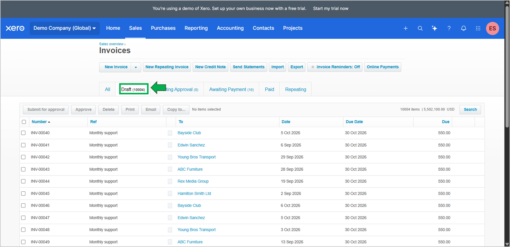
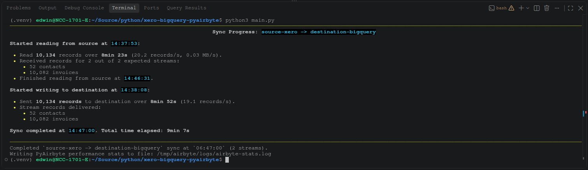

# Xero to BigQuery with PyAirbyte

A Python pipeline that uses PyAirbyte to replicate Xero contacts and invoices into Google BigQuery.

## What it does

1. Loads configuration from environment variables, including a local `.env` file.
2. Configures the `source-xero` connector with Xero client credentials, a tenant ID, and a start date of `2005-01-01T00:00:00Z`.
3. Selects the Xero `contacts` and `invoices` streams.
4. Configures the `destination-bigquery` connector using a Google Cloud service-account JSON file.
5. Writes the selected streams to the configured BigQuery dataset.

The current implementation sets `cache=False` and `force_full_refresh=True` in the destination write call. It bypasses the local DuckDB cache for that operation and requests a full refresh. **This script is not an incremental-sync implementation.**

## Project files

```text
.
├── config.py
├── main.py
├── requirements.txt
├── source_destination_setup.py
├── .env.example
├── .gitignore
└── LICENSE
```

Keep `.env` and the Google Cloud service-account key local. Do not commit either to Git.

## Requirements

- Python compatible with the pinned dependencies in `requirements.txt`
- Docker installed and running, because connector setup requests Docker images
- A Xero app configured for the authentication flow used by the Xero source connector
- Access to the intended Xero organization and its tenant ID
- A Google Cloud project with BigQuery enabled
- A Google Cloud service-account JSON key with permissions sufficient to write to the target dataset
- Docker installed and running

Check the current Xero and connector documentation for the app configuration and permissions required by your environment.

## 1. Create a virtual environment

Run these commands from the project directory:

```bash
python3 -m venv .venv
source .venv/bin/activate
python -m pip install --upgrade pip
pip install -r requirements.txt
```

## 2. Configure environment variables

Copy the example file to create your local `.env`:

```bash
cp .env.example .env
```

Edit `.env` with your own values:

| Variable | Purpose |
|---|---|
| `GOOGLE_APPLICATION_CREDENTIALS` | Path to the Google Cloud service-account JSON key file |
| `GOOGLE_CLOUD_PROJECT` | Google Cloud project ID |
| `BIGQUERY_DATASET_ID` | Destination BigQuery dataset ID |
| `BIGQUERY_DATASET_LOCATION` | BigQuery dataset location, such as `US` |
| `XERO_CLIENT_ID` | Client ID for the Xero app |
| `XERO_CLIENT_SECRET` | Client secret for the Xero app |
| `XERO_TENANT_ID` | Tenant ID for the Xero organization |

Use the actual dataset location configured in BigQuery. Keep `.env` and the service-account JSON key outside version control.

`config.py` raises a `ValueError` if a required environment variable is missing.

## 3. Run the pipeline

Make sure Docker is running, `.env` is configured, and the service-account JSON path is valid. Then run:

```bash
python main.py
```

The script selects the `contacts` and `invoices` streams and writes them to the configured BigQuery destination. Connector images may need to be installed or pulled on the first run.

## Refresh behavior and limitations

- The script selects only `contacts` and `invoices`.
- The source start date is `2005-01-01T00:00:00Z`.
- `cache=False` tells the write call not to use the local DuckDB cache for this operation.
- `force_full_refresh=True` requests a full refresh. Do not describe this implementation as an incremental-sync workflow.
- The script does not currently accept command-line arguments for stream selection or sync mode.
- Check the resulting tables and refresh behavior in BigQuery after running it.

## Sample Data
During my test, I used the Xero Demo Company (Global) with 52 contacts and 10,082 invoices.

Below is a preview of the 52 contacts in Xero:


Of the 10,082 invoices, 10,004 are drafts. You can preview some of them here:



## Sample Output

Below is a sample output from the initial full refresh sync:




## Troubleshooting

- **Missing environment variable:** Check that `.env` exists in the project root and contains all required variable names.
- **Credential file not found:** Verify that `GOOGLE_APPLICATION_CREDENTIALS` points to the service-account JSON file.
- **Docker or connector error:** Ensure Docker is installed and running, then review the connector output.
- **Xero authorization or tenant error:** Verify the Xero app configuration, client credentials, tenant ID, and access to the intended organization.
- **BigQuery write error:** Verify the project ID, dataset ID, dataset location, and service-account permissions.

## Security

Never commit `.env`, OAuth client secrets, service-account JSON keys, access tokens, refresh tokens, or exported financial data. Removing a secret in a later commit does not erase it from Git history; revoke or rotate an exposed credential.

## License

This project is licensed under the MIT License. See [LICENSE](LICENSE).
